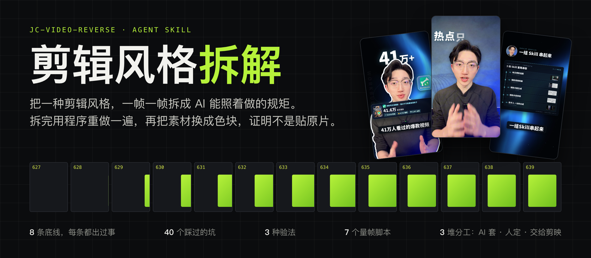
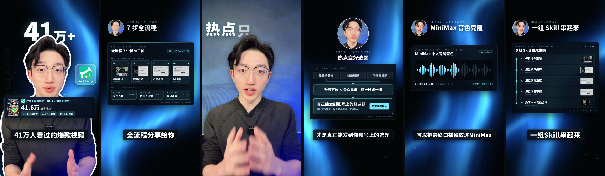
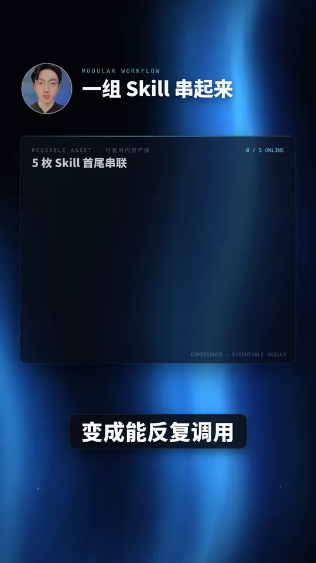
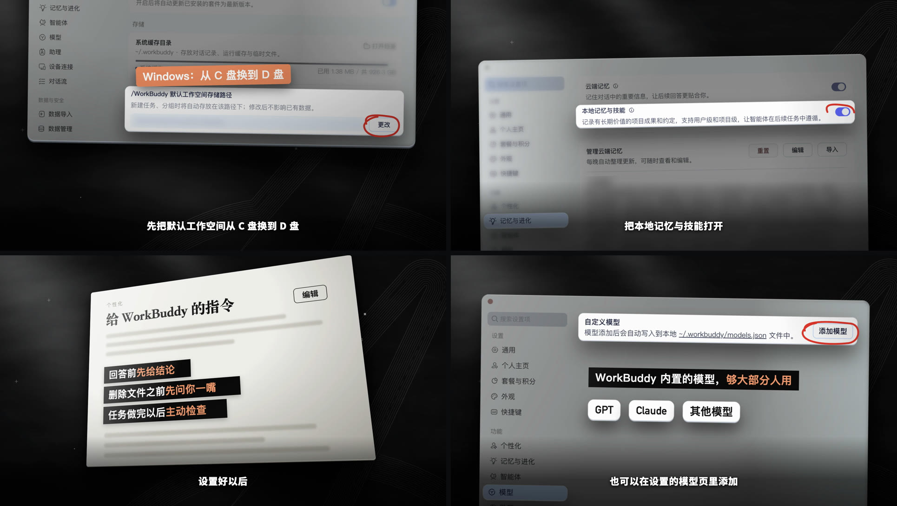
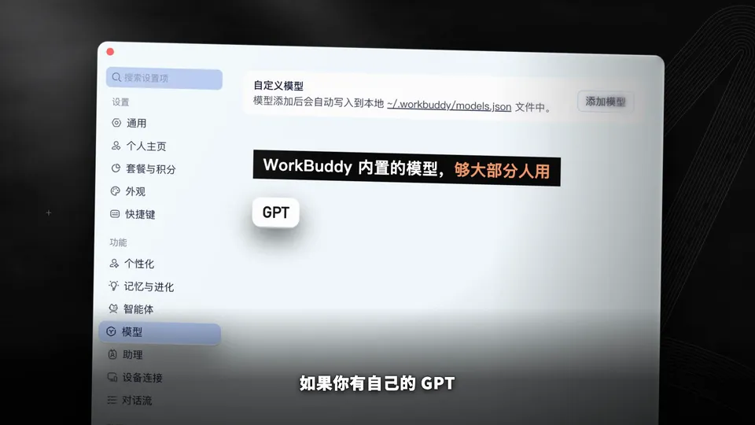
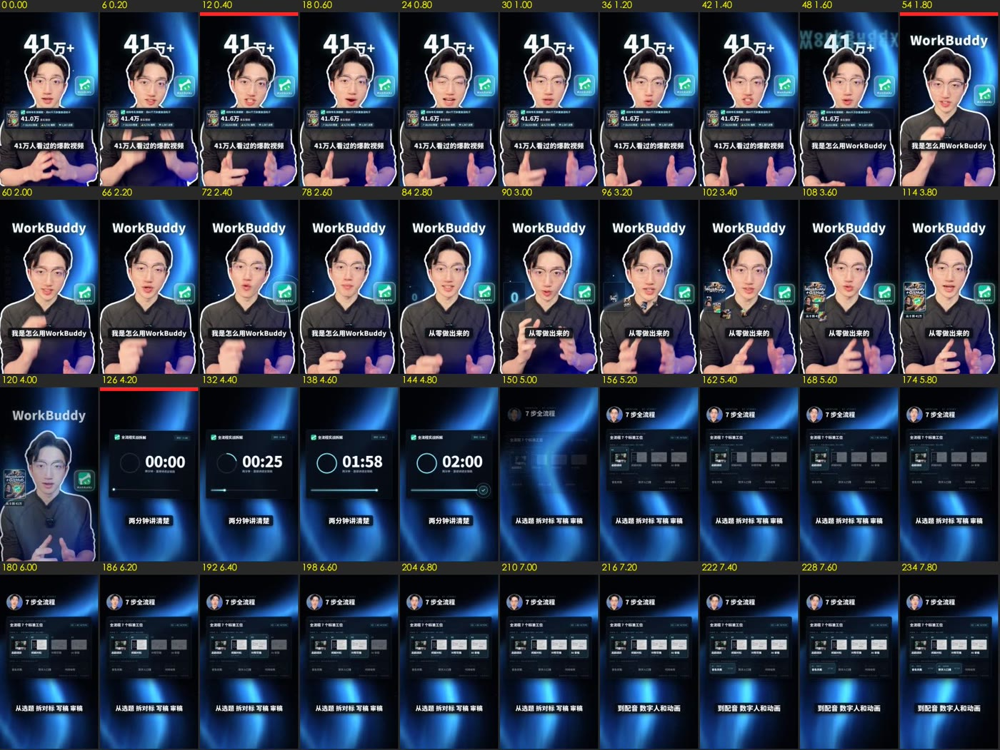
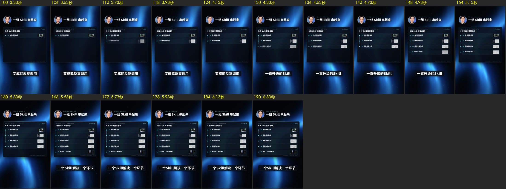
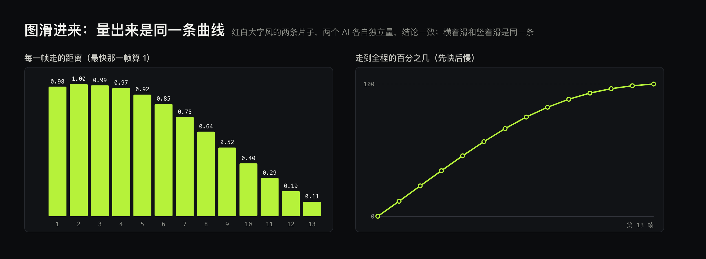

<div align="center">



# 剪辑风格拆解 · jc-video-reverse

**看到一条剪得好的片子，让你的 AI 把它的剪辑风格拆成一套照着就能做的规矩。**

[](LICENSE) [](https://agentskills.io) [](#安装)

```sh
npx skills add jincheng2026/jc-video-reverse
```

[它是什么](#它是什么) · [快速开始](#快速开始) · [看效果](#看效果) · [凭什么信它](#凭什么信它) · [做不到的](#做不到的) · [安装](#安装) · [English](#english)

</div>

---

## 它是什么

jc-video-reverse 是一个 Agent Skill。你给它同一种剪辑风格的两三条成片，它一帧一帧地看，交回一份「风格说明包」：这种风格每一屏怎么排、东西怎么动、用几帧、走什么曲线、标注和大字怎么出、声音卡在哪。

装好以后，你可以让 AI：

- 把一位博主的剪辑风格拆成规矩，拿去给剪辑师照着剪，或者做成这种风格的剪辑模板
- 只问一个动效：「这个是怎么出来、怎么消失的」，它把那几帧排开，量出用几帧、什么曲线
- 拆完自己验一遍：照拆解重做一屏和原片逐帧比，再把素材换成色块，证明不是从原片贴的
- 把活分好：哪些 AI 直接套、哪些要剪辑师定、哪些交给剪映的自带特效

适合想让 AI 照某种风格剪片的博主，和带剪辑团队、想把好风格变成固定做法的人。它只拆剪辑和包装，不拆文案，也不替你剪新片。

## 快速开始

**第 1 步：安装**

在终端运行：

```sh
npx skills add jincheng2026/jc-video-reverse
```

不想开终端，就直接跟你的 AI 说「帮我安装这个 Skill：https://github.com/jincheng2026/jc-video-reverse 」。其他装法见下文[安装](#安装)。

**第 2 步：把片子交给它**

把下面这段整个发给你的 AI（Claude Code、Codex、WorkBuddy 都行），把片子的路径或链接贴在最后：

```text
用 jc-video-reverse 这个 Skill 拆一下这种剪辑风格，做完把风格说明包的完整路径发给我。
没装这个 Skill 就先照 https://github.com/jincheng2026/jc-video-reverse 的说明装好；
缺 ffmpeg、numpy、Pillow 这些就直接装，要我输密码或点授权时提醒我。
拆完是给剪辑师在剪映里照着做用的。同一种风格的片子在这里（最新的排最前）：
```

同一种风格最好给两到三条。只给一条也能拆，但分不出哪些是这种风格固定的、哪些只是这一条的。

**第 3 步：在同一个对话里接着问**

拿到说明包以后，直接接着说，不用重新发上面那段：

```text
第 12 屏那个卡片是怎么飞进来的，逐帧排开给我看
把「人来定」那一堆再拆细一点，哪些我的剪辑师十分钟就能定
```

---

## 看效果

### 拆完以后，我剪出来的两种风格

我是做 AI 内容的博主。下面两种风格，都是我先拆了别人的剪辑风格，再照拆出来的规矩剪成自己的片子。名字是按画面颜色起的。

#### 靛青流光风（竖屏口播）

深黑底上一条靛青色的流光，信息全装进同一种深色卡片，只用一种冰青色做强调。这是用这个 Skill 拆完一种录屏教程口播的风格之后做出来的，现在是我大号的默认风格。



<p align="center"></p>

#### 黑台橙标风（横屏教程）

黑色舞台上放一块带厚度、微微倾斜的窗口，要点用橙色标签贴上去，要点的按钮手画一个红圈。这一种是这个 Skill 定型之前的一次逐帧拆解做出来的。



<p align="center"></p>

拆解只交规矩和零件，片子是另外剪的。拆得清楚，剪的时候 AI 才知道每一屏该放什么、东西怎么进来、用几帧。

<sub>画面都来自作者自己发过的视频。</sub>

### 它怎么看一条片子：每 0.2 秒一格，一张不落



这是 Skill 自带的 `quanpian.py` 在靛青流光风那条片子前 45 秒上真跑出来的总览图（这里截了前 8 秒）。每格上面的黄字是帧号和秒数，顶上有红条的是程序找出来的换屏候选。它同时报告：45 秒里有 17 个换屏候选，87% 的时间画面在动。

为什么要看这么细：我第一次拆别人的片子时半秒看一帧，写出「换屏大多是直接切」；逐帧重看，58 屏里直接切的只有 15 屏，26 屏是「切到黑、停一下、图再滑进来」。

### 一个动作，逐帧排开



`huamiantiao.py` 把一小段逐帧排开。这一段是五个 Skill 一条接一条亮起来：看帧号就能数出每条隔多久出来、每条用几帧，口播说到哪一句时出第几条。拆解里写的每一个帧数，都要能指回这样一张图。

### 动效不是「看着挺丝滑」，是量出来的数



拆「红白大字风」（一种颜值分析口播）时，两个 AI 各自独立量，结论一样：两条片子里图滑进来用的是同一条曲线，横着滑和竖着滑也是同一条。每屏不同的只有三样：第几帧开始、走多远、用几帧。知道了这个，AI 就不用每一屏重新猜。

---

## 它交回什么

一个工作文件夹，入口是 `风格说明包.md`：

| 说明包里的一节 | 写什么 |
| --- | --- |
| 节奏 | 平均几秒一屏、真人出镜占几成 |
| 画面排法清单 | 这种风格反复用的那十来种排法，每种长什么样、用了几屏，配一小段原片 |
| 什么话配什么排法 | 举例的话配哪种、对比的话配哪种，并写明这套规矩验没验过 |
| 动作清单 | 每种动作用几帧、是不是固定曲线（是就给出每一帧的数）、哪些屏用了 |
| 标注、大字和字幕 | 颜色、线宽、字体最像哪款、差在哪、怎么出来 |
| 声音 | 多久一个音效、卡在换屏上还是卡在动作上 |
| 几条对着看 | 哪些是这种风格固定的，哪些只是某一条片子的 |
| 没查的 | 一条一条列，不藏 |

最后把每一样东西分进三堆，每样后面写依据：

| 哪一堆 | 什么样的东西放这里 | 例子（红白大字风） |
| --- | --- | --- |
| AI 直接套 | 量得准、几条片子都一样、重做验过的 | 换屏在哪一帧、图摆在哪、图滑进来的曲线、照坐标画标注 |
| 人来定 | 要专业判断或要挑素材的 | 每句话配哪种排法（AI 先配、人改）、每屏用哪几张照片、点和线标在脸上哪里 |
| 交给剪映 | 只出现一两次的自带特效 | 放射状拖影、带透视的翻页、光斑扫过 |

「人来定」这一堆不许缩水。目标不是替掉剪辑师，是让他只做判断和只有他能做的那一小部分。

---

## 凭什么信它

拆解最容易出的毛病是：写得头头是道，照着做不出来。所以拆完要验三样，哪样没验就在说明包里写「没验」。

| 验法 | 怎么做 | 验的是什么 |
| --- | --- | --- |
| 留一条片子猜排法 | 让一个没看过答案的 AI，只凭从第一条归出来的规矩，猜第二条每一屏怎么排，再对答案 | 「什么话配什么画面」换一条片子还成不成立 |
| 重做一屏逐帧比 | 每种排法挑一屏，第一版只照拆解文件做、不许看原片，做完和原片每一帧比 | 排法、位置、动作、帧数写得对不对 |
| 素材换成色块重跑 | 重做程序不改，只把素材换成色块原样再跑，拼成「原片、重做、去掉原片素材」三栏对比片 | 重做出来的东西是程序画的，还是从原片贴的 |

第三样是吃过亏才加的。我第一次让 AI 复刻别人的片子，脸上的标注看着和原片「对得上」，换成色块一跑全没了：它是连着照片从原片截下来贴上去的，总结里一个字没提。

第二样也抓到过真错。有一屏拆解写的是「这一块保持原来的亮度」，照着重做，43 帧里 21 帧对不上；逐帧对照才看出那一块其实是复制出来放大了 1.165 倍浮起来。改了拆解再重做，降到 12 帧。

还有八条底线，每一条后面都写着它出过的事。挑三条：

- **量的、看的、猜的分开写，数用脚本数。** 手数的统计把 10 屏写成 9 屏；「大约 8 种排法」实际 11 种。
- **一条片子的数不算这种风格的规矩。** 「切到黑再让图滑进来」第一条占 45%，第二条只占 24%。
- **验收的尺子归审的一方。** 让做的 AI 自己找「像素差最小」的参数，它把清楚的叠化凑成一团糊，数反而变好了。

全部 40 个坑在 [references/踩过的坑.md](references/踩过的坑.md)，每个都写了哪天、哪条片子、错出来什么样、怎么发现的、以后怎么防。

---

## 做不到的

这些是实测出来的，不是客气话。

- **整条片子逐帧做到和原片一样，做不到，也不该做。** 两个 AI 花了约 7 个半小时逐帧重做两条片子，对不上的帧只从 23.9% 降到 19.2%、从 17.6% 降到 11.0%，目标是 3%。卡住的是剪映自带的特效，每种只出现一两次，要一种一种仿。所以这个 Skill 只让每种排法重做一屏来验拆解，重做最多两轮。
- **「什么话配什么画面」目前不能让 AI 自动套。** 留一条猜排法：66 屏猜中 17 屏，全猜同一种也能中 13 屏。只有过渡的话猜得准（6 屏中 5 屏）。所以这一项归「人来定」，AI 只能先配一版给人改。
- **重做一屏也常常过不了线。** 过线标准是一屏里对不上的不超过 2 帧。红白大字风两条片子按这个标准过线的，是 58 屏里的 13 屏和 66 屏里的 32 屏；前面说的「保持原来的亮度」那一屏，改到第三版还有 12 帧。
- **声音这一步没有现成工具。** 找音效起点我用的是自己一个还没公开的工具，仓库里只有「把音效对到画面上」的脚本，音效时间表要你另找办法出。这一步我自己也只在 30 秒的片子上试过，没有人对着耳朵核过。
- **只在 macOS 上跑过。** Windows 和 Linux 没试。
- **能省剪辑师多少时间，没测。**

---

## 安装

**方式一：跟你的 AI 说（推荐）**

```text
帮我安装这个 Skill 的最新版本：https://github.com/jincheng2026/jc-video-reverse
```

**方式二：一行命令**

```sh
npx skills add jincheng2026/jc-video-reverse
```

**方式三：克隆到 Skill 文件夹**

```sh
git clone https://github.com/jincheng2026/jc-video-reverse.git ~/.claude/skills/jc-video-reverse
```

装完看一眼安装的文件夹里是不是有 `SKILL.md`、`references/`、`scripts/`、`examples/` 四样，缺了就用方式三再装一次。

要用到：`python3`（带 `numpy` 和 `Pillow`）、`ffmpeg`、`zsh`。缺什么 AI 会自己装。

电脑同时开着很多 AI 对话、跑不动重活时，可以配另一台电脑替你跑抽帧和渲染（可选，写法见 [scripts/pao.sh](scripts/pao.sh) 开头）。不配就全在本机跑。

---

## 里面有什么

```text
jc-video-reverse/
├── SKILL.md                  入口：八条底线、六步怎么做、遇到特殊情况怎么办
├── references/
│   ├── 踩过的坑.md            40 个坑，开工前读一遍，交付前对一遍
│   ├── 怎么拆.md              第 1 到 4 步：全片过一遍、逐屏拆、逐帧量、几条对着看
│   ├── 怎么验.md              第 5 步：猜排法、重做逐帧比、换色块
│   ├── 说明包怎么写.md         第 6 步：说明包的结构、三堆怎么分
│   └── 派给别的AI的话.md       三份现成的任务说明：量动效、盲猜排法、照拆解重做一屏
├── scripts/
│   ├── quanpian.py           全片每一帧都量：换屏候选、动作区间，出总览图和动作条
│   ├── huamiantiao.py        一小段逐帧排开看，可以只看画面一块再放大
│   ├── yanshou.py            逐帧验收：原片和重做每一帧量四个数
│   ├── duizhaotiao.py        原片和重做上下逐帧对照
│   ├── sekuai.py             给每个素材做同名同尺寸的色块替身
│   ├── sanlian.py            拼「原片、重做、去掉原片素材」三栏对比片
│   ├── shengyin.py           把音效对到换屏和动作上
│   └── pao.sh                跑上面这些脚本；配了另一台电脑时把重活送过去跑
└── examples/liangju/         拆红白大字风时用过的量具和渲染程序，照原样放着，拿去改
```

---

## 背后的故事

2026 年 11 月，我想让 AI 照一位博主的风格剪片子，就让它先把他两条片子的剪辑拆出来。

第一版它半秒看一帧，交回来一份看着很完整的拆解。我说不行：「我觉得 0.2 秒一帧，甚至有的地方 0.1 秒一帧还差不多，因为有的地方动效比较密集，如果 0.5 秒一帧，根本无法拆解到不少动效的质感，包括怎么出现，怎么消失。」逐帧重看以后，前面写的结论错了一大片。

接着我让它照拆解把片子重做出来，看着真像。但我要确认一件事：「你到底是换了一下字幕，其他的啥也没换，还是你已经掌握了他这种风格剪辑的方法。」把素材换成色块一跑，答案出来了：有一部分是从原片贴的。

这两天踩的坑、量出来的数、被验出来的错，全记下来了，就是这个 Skill。后来又拿它拆了两种别的风格，新踩的坑接着记在里面。上面的靛青流光风，就是其中一次拆完以后做成的。

我的想法一直是这句：「不 100% 代替剪辑师，而是让剪辑师效率比现在高 10 倍，尽量让他只需要负责判断和少部分只有他才能做的事情。」

---

## 作者

何锦成 · [抖音](https://www.douyin.com/user/MS4wLjABAAAABESEqXIiQQyuKbVjSePQft8QAwWx3Lxh1ooU71bMKrVWPicmTpHdyrddhDwbURyD) · 视频号「何锦成本人」

## 许可证

本项目采用 [CC BY-NC 4.0](LICENSE) 许可证。

- 个人使用、学习、研究与非商业项目可以直接使用。
- 公开发布衍生作品时，请注明来源。
- 商业用途需要单独授权，请联系作者。

`assets/` 里的画面来自作者自己的视频，含作者本人形象，只用于展示这个 Skill，不随上面的许可证授权用于别处。

---

## English

**jc-video-reverse** is an agent skill that reverse-engineers a video editing style. Give it two or three finished videos in the same style; it measures every frame (layouts, motion curves, annotations, titles, sound cues), writes down which kind of line gets which kind of layout, then checks its own breakdown three ways: a blind test on a held-out video, a frame-by-frame comparison between the original and a screen rebuilt from the written breakdown alone, and a re-render with every asset swapped for colour blocks to prove nothing was pasted from the original. The output is a style pack split into three piles: what an AI can apply directly, what a human editor must decide, and what is better left to the editing app's built-in effects.

Install: `npx skills add jincheng2026/jc-video-reverse`. Requires python3 (numpy, Pillow), ffmpeg and zsh. Tested on macOS only. The skill content is in Chinese. Licensed CC BY-NC 4.0 (commercial use requires the author's permission); the frames in `assets/` come from the author's own videos and are for showcasing this skill only.
